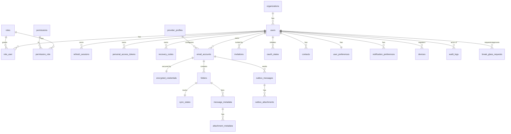

# MbunieMail — Database Design

Version 0.1 · 2026-10-14 · Engine: MariaDB 11.x (InnoDB, `utf8mb4_unicode_ci`). The dev host runs 11.8.

> **Implementation notes (Phase 3, 2026-10-14):** the schema is implemented in `backend/database/migrations`. Differences from the first draft:
> - `users.mfa_pending_secret` added: re-enrolment never overwrites an active factor.
> - `devices` uses a server ULID plus `client_device_id` (unique per user), not a client-chosen primary key.
> - `audit_chain_head` (single row) serializes hash-chain appends. `audit_logs.id` is assigned explicitly, so gaps are detectable.
> - `personal_access_tokens.refresh_session_id` links access tokens to the refresh session that issued them. Sessions shown to users are refresh-token **families**.
> - `outbox_messages.request_hash` (idempotency body check) and `outbox_attachments.user_id` (ownership before a message exists) added.
> - `contacts` and `notification_preferences` are created in the mail-account migration.
> - **Phase 4:** `oauth_states` gained `session_family_id`, `completion_hash` (unique), `pending_payload_enc` (encrypted tokens awaiting completion) and `completed_at` (migration `2026_10_14_000800`, expand-only, with a working `down()`).
> - **Phase 5:** migration `2026_10_14_000900` adds `message_metadata.provider_thread_id`, `references_json` and `reply_to_json` (threading and reply headers), `sync_states.history_id` (Gmail per-folder checkpoint), and `outbox_messages.next_attempt_at`, `recipient_count` and `forward_of_metadata_id`. All are expand-only, and rollback was verified.

## 1. Principles
- ULID primary keys (`CHAR(26)`) for every externally referenced entity, so IDs cannot be enumerated.
- Every user-owned row reaches `users.id` through foreign keys. `organization_id` exists on top-level tables to allow future multi-tenancy (single org "MbunieTech" in release 1).
- Secrets are stored only encrypted (envelope) or hashed. Plaintext columns for secrets are forbidden.
- Mail content is not persisted (see SDD ADR-002). Only metadata, of which subject and snippet are encrypted.
- All schema changes go through Laravel migrations, and each has a tested `down()`.

## 2. ER diagram

## 3. Tables

### 3.1 Identity and access
**organizations**: `id` ULID PK · `name` VARCHAR(120) · `allowed_domains` JSON (e.g. `["mt.co.tz"]`) · timestamps.

**users**
| Column | Type | Notes |
|---|---|---|
| id | CHAR(26) PK | ULID |
| organization_id | CHAR(26) FK → organizations | indexed |
| name | VARCHAR(120) | |
| email | VARCHAR(254) | **UNIQUE**, lower-cased login identifier |
| recovery_email | VARCHAR(254) NULL | for password reset |
| password | VARCHAR(255) | Argon2id (Laravel `Hash`) |
| status | ENUM('invited','active','suspended','deactivated') | indexed |
| mfa_secret | TEXT NULL | `encrypted` cast |
| mfa_confirmed_at | TIMESTAMP NULL | |
| mfa_last_used_step | BIGINT NULL | TOTP replay protection |
| password_changed_at | TIMESTAMP NULL | |
| last_login_at | TIMESTAMP NULL | |
| deactivated_at | TIMESTAMP NULL | drives purge |
| timestamps | | |

**roles** (`id`, `name` UNIQUE, `label`), **permissions** (`id`, `name` UNIQUE, e.g. `users.manage`, `audit.read`, `policies.manage`, `admins.manage`, `health.read`, `jobs.manage`, `breakglass.approve`), **role_user** (PK `user_id, role_id`), **permission_role** (PK `permission_id, role_id`). No permission grants mail content.

**personal_access_tokens** (Sanctum): standard columns (`token` SHA-256 UNIQUE, `abilities`, `expires_at`) plus `refresh_session_id` FK.

**refresh_sessions**
| Column | Type | Notes |
|---|---|---|
| id | CHAR(26) PK | |
| user_id | FK users (cascade) | indexed |
| family_id | CHAR(26) | indexed. Reuse revokes the whole family |
| token_hash | CHAR(64) | **UNIQUE**, SHA-256 |
| device_id | FK devices NULL | |
| ip_prefix | VARCHAR(45) | /24 or /48 truncation |
| user_agent | VARCHAR(255) | |
| rotated_at | TIMESTAMP NULL | non-null once used. Reuse means theft |
| revoked_at | TIMESTAMP NULL | |
| expires_at / idle_expires_at | TIMESTAMP | |

**recovery_codes**: `id`, `user_id` FK, `code_hash` (Argon2id), `used_at` NULL.
**password_reset_tokens**: `email` PK, `token` (hash), `created_at` (Laravel standard; 30 min TTL).
**invitations**: `id`, `email`, `token_hash` UNIQUE, `role_id`, `invited_by` FK users, `expires_at`, `accepted_at`.
**devices**: `id`, `user_id`, `platform` ENUM('android','windows'), `name`, `push_token` (encrypted, nullable), `last_seen_at`.

### 3.2 Mail accounts and credentials
**provider_profiles**
| Column | Type | Notes |
|---|---|---|
| id | CHAR(26) PK | |
| key | VARCHAR(40) UNIQUE | `hostinger`, `gmail` |
| driver | ENUM('imap_smtp','gmail') | |
| imap_host / imap_port / imap_encryption | VARCHAR / SMALLINT / ENUM('ssl','starttls') | null for gmail |
| smtp_host / smtp_port / smtp_encryption | same | |
| saves_sent_automatically | BOOLEAN | verified per provider |
| max_connections_per_mailbox | TINYINT | default 2 |
| enabled | BOOLEAN | |

**email_accounts**
| Column | Type | Notes |
|---|---|---|
| id | CHAR(26) PK | |
| user_id | FK users (cascade) | indexed |
| provider_profile_id | FK | |
| email_address | VARCHAR(254) | **UNIQUE(user_id, email_address)** |
| display_name | VARCHAR(120) | |
| status | ENUM('pending','active','syncing','auth_failed','provider_unreachable','throttled','disabled') | indexed |
| last_error_code | VARCHAR(40) NULL | ProviderError code, no raw server text |
| last_synced_at | TIMESTAMP NULL | |
| next_sync_at | TIMESTAMP NULL | scheduler index |
| backoff_attempts | TINYINT | |
| signature_html | MEDIUMTEXT NULL | sanitized |
| capabilities | JSON | cached capability flags |
| gmail_history_id | VARCHAR(32) NULL | |

Index: `(status, next_sync_at)` for the scheduler.

**encrypted_credentials**
| Column | Type | Notes |
|---|---|---|
| email_account_id | CHAR(26) PK, FK cascade | 1:1 |
| kind | ENUM('password','oauth') | |
| ciphertext | BLOB | XChaCha20-Poly1305(secret JSON, DEK, AAD=account_id) |
| nonce | BINARY(24) | |
| wrapped_dek | BLOB | DEK sealed by the KEK |
| kek_version | SMALLINT | rotation |
| updated_at | TIMESTAMP | |

### 3.3 Mail metadata cache
**folders**: `id` ULID, `email_account_id` FK cascade, `remote_name` VARCHAR(255) (UTF-7 decoded), `delimiter`, `role` ENUM('inbox','sent','drafts','archive','trash','spam','custom'), `selectable` BOOL, `unread_count`, `total_count`. **UNIQUE(email_account_id, remote_name)**. Index `(email_account_id, role)`.

**sync_states**: `folder_id` PK FK cascade, `uidvalidity` BIGINT UNSIGNED, `last_uid` BIGINT UNSIGNED, `highest_modseq` BIGINT UNSIGNED NULL, `window_start` DATE, `last_full_sync_at`, `last_incremental_at`, `last_error_code`, `attempts`.

**message_metadata**
| Column | Type | Notes |
|---|---|---|
| id | CHAR(26) PK | |
| email_account_id | FK cascade | denormalized for scoping |
| folder_id | FK cascade | |
| uidvalidity | BIGINT UNSIGNED | |
| uid | BIGINT UNSIGNED | Gmail: 0 |
| provider_message_id | VARCHAR(64) NULL | Gmail message id |
| message_id_header | VARCHAR(255) | indexed `(email_account_id, message_id_header(191))` |
| thread_key | CHAR(26) | indexed `(email_account_id, thread_key)` |
| in_reply_to | VARCHAR(255) NULL | |
| references_hash | CHAR(64) NULL | references stored compactly |
| from_name / from_email | VARCHAR(255) / VARCHAR(254) | `from_email` indexed for autocomplete |
| to_json / cc_json | JSON | address lists |
| subject_enc | BLOB | app-encrypted (APP_KEY) |
| snippet_enc | BLOB NULL | app-encrypted. NULL if `MAIL_CACHE_SNIPPETS=false` |
| sent_at | DATETIME | |
| internal_date | DATETIME | index `(folder_id, internal_date DESC)` |
| size_bytes | INT UNSIGNED | |
| is_seen / is_flagged / is_answered / is_draft | BOOLEAN | |
| has_attachments | BOOLEAN | |
| auth_results | JSON NULL | parsed SPF/DKIM/DMARC verdict |

**UNIQUE(folder_id, uidvalidity, uid)** (IMAP dedup) · **UNIQUE(email_account_id, provider_message_id)** (Gmail dedup; NULLs allowed).
*Search on subject:* because subject is encrypted, subject search goes to IMAP `SEARCH SUBJECT`. Sender and date search use plaintext indexed columns.

**attachment_metadata**: `id`, `message_metadata_id` FK cascade, `part_id` VARCHAR(32), `filename` (sanitized), `mime_type`, `size_bytes`, `content_id` NULL, `is_inline`.

### 3.4 Outbox
**outbox_messages**
| Column | Type | Notes |
|---|---|---|
| id | CHAR(26) PK | |
| user_id / email_account_id | FKs | |
| idempotency_key | VARCHAR(80) | **UNIQUE(user_id, idempotency_key)** |
| kind | ENUM('draft','send') | |
| status | ENUM('draft','queued','sending','sent','failed','unknown') | index `(status, updated_at)` |
| message_id_header | VARCHAR(255) | generated before submission |
| payload_enc | MEDIUMBLOB | encrypted compose payload (recipients, subject, html). **Deleted 24 h after `sent`** |
| attempts | TINYINT | |
| last_error_code | VARCHAR(40) NULL | |
| claimed_at / sent_at | TIMESTAMP NULL | |
| in_reply_to_metadata_id | CHAR(26) NULL | |

**outbox_attachments**: `id`, `outbox_message_id` FK cascade, `storage_path` (random name, private disk), `filename`, `mime_type`, `size_bytes`, `sha256`, `scan_status` ENUM('pending','clean','infected','not_scanned').

### 3.5 Gmail OAuth
**oauth_states**: `state_hash` CHAR(64) PK, `user_id` FK, `provider` VARCHAR(20), `pkce_verifier_enc` BLOB, `redirect_after` VARCHAR(40) (enum-like, never a URL), `expires_at`, `consumed_at`. Purged hourly.

### 3.6 Preferences and contacts
**user_preferences**: `user_id` PK, `theme`, `density`, `default_account_id`, `remote_images` ENUM('never','ask','trusted_senders'), `show_subject_in_notifications` BOOL, `trusted_image_senders` JSON.
**notification_preferences**: `id`, `user_id`, `email_account_id`, `folder_role`, `enabled`, `quiet_from`, `quiet_to`. UNIQUE(user_id, email_account_id, folder_role).
**contacts**: `id`, `user_id` FK, `email` VARCHAR(254), `name`, `source` ENUM('manual','derived'), `last_used_at`, `use_count`. UNIQUE(user_id, email).

### 3.7 Audit and operations
**audit_logs** (append-only)
| Column | Type | Notes |
|---|---|---|
| id | BIGINT PK AI | ordering for hash chain |
| occurred_at | TIMESTAMP(6) | |
| actor_user_id | CHAR(26) NULL | no FK (survives user deletion) |
| actor_type | ENUM('user','admin','system') | |
| action | VARCHAR(80) | e.g. `auth.login.failed`, `admin.user.suspended` |
| target_type / target_id | VARCHAR(40) / CHAR(26) | |
| result | ENUM('success','failure','denied') | |
| ip | VARBINARY(16) | |
| user_agent | VARCHAR(255) | |
| context | JSON | **allow-listed keys only, never content or secrets** |
| prev_hash / hash | CHAR(64) | SHA-256(prev_hash ‖ canonical row) |

Indexes: `(actor_user_id, occurred_at)`, `(action, occurred_at)`, `(target_type, target_id)`.
DB permissions: the app user has `INSERT, SELECT` only on `audit_logs`. The retention purge runs as a separate `mbuniemail_maint` user.

**break_glass_requests**: `id`, `requested_by`, `subject_user_id`, `justification` TEXT, `legal_reference`, `approved_by` NULL, `approved_at`, `expires_at`, `status`, `closed_at`. CHECK `approved_by <> requested_by` (enforced in app plus trigger).

**jobs / failed_jobs / job_batches**: Laravel standard (`database` queue fallback). `failed_jobs.payload` is redacted before insert.
**settings**: `key` PK, `value` JSON, `updated_by`, `updated_at` (application-wide security settings).
**cache / sessions**: Laravel standard (admin web sessions in Redis in production).

## 4. Isolation rules
1. Every content query starts from `$user->emailAccounts()`. Global query scopes on `EmailAccount`, `Folder`, `MessageMetadata` and `OutboxMessage` are **not** used (they are invisible and easy to bypass). Explicit scoping plus policies are mandatory and covered by SEC-T13.
2. Route model binding for content models uses a scoped resolver: `resolveRouteBinding` joins to `email_accounts.user_id = auth id`, and returns 404 otherwise.
3. Admin queries never select `subject_enc`, `snippet_enc` or `payload_enc` (enforced via a separate read model and an architecture test).

## 5. Encryption and classification
| Column(s) | Classification | Protection |
|---|---|---|
| encrypted_credentials.* | Secret | Envelope (KEK file) |
| users.mfa_secret, devices.push_token, oauth_states.pkce_verifier_enc | Secret | APP_KEY `encrypted` cast |
| password, recovery_codes, token hashes | Secret | One-way hash |
| subject_enc, snippet_enc, outbox payload | Confidential | APP_KEY encryption (AES-256-CBC + HMAC, Laravel Crypt) |
| from/to/cc, dates | Confidential | DB access control, encrypted backups, TLS |
| audit_logs | Confidential, integrity | append-only plus hash chain |

At rest: also enable MariaDB InnoDB tablespace encryption (`file_key_management`) where the VPS allows, as defence in depth. Production DB connections over the network require TLS.

## 6. Retention and deletion
| Trigger | Action | Job |
|---|---|---|
| Account unlinked | Delete credential immediately. Cascade folders, metadata and sync state within 24 h | `PurgeAccountDataJob` |
| User deactivated | Revoke tokens immediately. Unlink all accounts. Personal data deleted after 30 days (configurable) unless legal hold | `PurgeUserJob` |
| Outbox `sent` | `payload_enc` and attachments deleted after 24 h | `PruneOutbox` (hourly) |
| oauth_states | expired or consumed rows deleted hourly | `PruneOAuthStates` |
| refresh_sessions | expired or revoked rows deleted after 30 days | `PruneSessions` |
| audit_logs | older than 2 years deleted (maint user) after a signed export | `PruneAuditLogs` (monthly) |

## 7. Migration and rollback strategy
- One migration per logical change, named with a timestamp. Forward-only in production, but every migration has a working `down()` that is tested in CI (`migrate:fresh` → `migrate:rollback --step=N` → `migrate`).
- Expand / contract for breaking changes: add column, then dual-write, then backfill job, then switch reads, then drop the old column in a later release.
- Before production migrations: take a backup snapshot, run `php artisan migrate --pretend` for review, apply during the maintenance window, then health check.
- Rollback: `php artisan migrate:rollback --step=1` for the last batch. If data-destructive, restore from the pre-migration backup (BACKUP_AND_RESTORE.md).
- Because metadata is re-syncable from providers, the metadata tables can be truncated and re-synced as a last resort. Credentials and users cannot.
