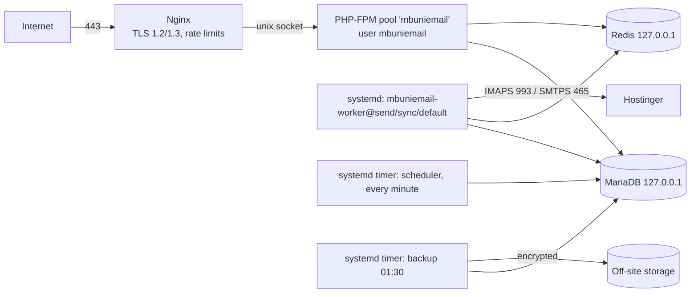

# MbunieMail — Deployment Guide

Version 0.1 · 2026-10-14. Applies to the backend (API, admin panel, workers). The Flutter apps are packaged separately (Phase 6).

> Configuration files referenced here live in `infra/` and were validated on 2026-10-14: `nginx -t` passed, `systemd-analyze verify` passed (worker exposure score 1.5), ShellCheck was clean, and the database grants and backup/restore were exercised (see TEST_RESULTS.md). **Still to be done on a real staging VPS:** a first deploy, the TLS scan (testssl.sh) and an external port scan.

## 1. Topology



One VPS: Ubuntu Server 24.04 LTS, 4 vCPU, 8 GB RAM, 80 GB SSD (sized for about 200 users × 3 mailboxes, SRS NFR-SCALE-001). A separate staging VPS of the same build is strongly recommended.

## 2. Prerequisites (owner: OPS)
- [ ] VPS with a static IPv4 address (and IPv6 if available). SSH access by key only.
- [ ] DNS: `A`/`AAAA` record for the API host, e.g. `mail-api.mt.co.tz` (**confirm the name**).
- [ ] An **authorized test** proving Hostinger accepts IMAP/SMTP logins from the VPS IP (SRS A-2).
- [ ] A notification mailbox for MbunieMail's own email (resets, invitations, alerts), e.g. `no-reply@mt.co.tz`.
- [ ] Off-site backup storage (S3-compatible bucket with object lock, or a second server) and an `age` key pair (§9).
- [ ] Named security owner and alert email address.

## 3. Base system
```bash
sudo apt update && sudo apt full-upgrade -y
sudo apt install -y nginx mariadb-server redis-server git unzip age curl ufw fail2ban unattended-upgrades \
  php8.4-fpm php8.4-cli php8.4-mysql php8.4-mbstring php8.4-xml php8.4-curl php8.4-intl php8.4-zip php8.4-bcmath php8.4-gd php8.4-redis
sudo dpkg-reconfigure -plow unattended-upgrades       # security updates automatically
sudo timedatectl set-timezone UTC                      # the app stores UTC; TOTP needs an accurate clock
sudo systemctl enable --now systemd-timesyncd
```
Use PHP from the Ubuntu archive or the ondrej/php PPA, as your policy allows; PHP 8.3+ is required. Install Composer from getcomposer.org and verify the installer's checksum.

**Accounts and directories**
```bash
sudo adduser --system --group --home /srv/mbuniemail --shell /usr/sbin/nologin mbuniemail
sudo adduser --system --group --no-create-home mbuniemail-backup
sudo adduser deploy && sudo usermod -aG mbuniemail deploy
sudo mkdir -p /srv/mbuniemail/{releases,shared/storage} /etc/mbuniemail /var/backups/mbuniemail /var/log/php
sudo chown -R deploy:mbuniemail /srv/mbuniemail && sudo chmod 750 /srv/mbuniemail
sudo chown -R mbuniemail:mbuniemail /srv/mbuniemail/shared/storage && sudo chmod -R 2770 /srv/mbuniemail/shared/storage   # deploy (group) caches config
sudo chown root:mbuniemail /etc/mbuniemail && sudo chmod 750 /etc/mbuniemail
sudo install -d -o mbuniemail -g mbuniemail -m 700 /etc/mbuniemail/keys          # credential KEK lives here
sudo chown mbuniemail-backup:mbuniemail-backup /var/backups/mbuniemail && sudo chmod 700 /var/backups/mbuniemail
```

**SSH hardening** (`/etc/ssh/sshd_config.d/10-mbuniemail.conf`): `PasswordAuthentication no`, `PermitRootLogin no`, `AllowUsers deploy <admin-user>`. Enable 2FA for the admin users if your policy requires it.

## 4. MariaDB
```bash
sudo mariadb-secure-installation        # remove anonymous users and the test DB; root keeps unix-socket auth
sudo tee /etc/mysql/mariadb.conf.d/90-mbuniemail.cnf <<'CNF'
[mysqld]
bind-address = 127.0.0.1
skip-name-resolve
local-infile = 0
character-set-server = utf8mb4
collation-server = utf8mb4_unicode_ci
CNF
sudo systemctl restart mariadb
```
Create the database and the four least-privilege accounts. Generate each password with `openssl rand -hex 24`. **Never paste them into chat or tickets.**
```sql
CREATE DATABASE mbuniemail CHARACTER SET utf8mb4 COLLATE utf8mb4_unicode_ci;
CREATE USER 'mbuniemail_app'@'localhost'     IDENTIFIED BY '<app password>';
CREATE USER 'mbuniemail_migrate'@'localhost' IDENTIFIED BY '<migrate password>';
CREATE USER 'mbuniemail_backup'@'localhost'  IDENTIFIED BY '<backup password>';
CREATE USER 'mbuniemail_maint'@'localhost'   IDENTIFIED BY '<maint password>';
```
- Store the migrator credentials in `/etc/mbuniemail/migrate.user` and `/etc/mbuniemail/migrate.pass` (owner `deploy`, mode 0400).
- Store the backup credentials in `~mbuniemail-backup/.my.cnf` (`[client] user=… password=…`, mode 0600).
- After the first migration: `sudo DB_NAME=mbuniemail MYSQL=mariadb infra/scripts/db-grants.sh`. This grants the app account INSERT/SELECT only on `audit_logs`; it was verified on 2026-10-14 that UPDATE, DELETE, DROP and CREATE are refused.

Optional: enable InnoDB data-at-rest encryption (`file_key_management`), as DATABASE_DESIGN §5 recommends.

## 5. Redis
Append `infra/redis/mbuniemail.conf` to `/etc/redis/redis.conf` (localhost only, password required, `FLUSHALL`/`CONFIG`/`DEBUG` disabled, `noeviction`), set a strong `requirepass`, then `sudo systemctl restart redis-server`.

## 6. TLS and Nginx
```bash
sudo mkdir -p /var/www/certbot
sudo sed 's/API_HOST/mail-api.mt.co.tz/g' infra/nginx/mbuniemail.conf | sudo tee /etc/nginx/sites-available/mbuniemail
# first obtain the certificate (temporarily serve only the port-80 block, or use certbot --nginx), then:
sudo apt install -y certbot && sudo certbot certonly --webroot -w /var/www/certbot -d mail-api.mt.co.tz -m <ops email> --agree-tos
sudo ln -s /etc/nginx/sites-available/mbuniemail /etc/nginx/sites-enabled/ && sudo rm -f /etc/nginx/sites-enabled/default
sudo nginx -t && sudo systemctl reload nginx
systemctl list-timers | grep certbot     # auto-renewal must be listed
```
Then verify from outside: `testssl.sh https://mail-api.mt.co.tz` (aim for grade A, no TLS 1.0/1.1), and `curl -I` showing HSTS, CSP, `X-Frame-Options` and `nosniff`. Enable HSTS `includeSubDomains` only after confirming every subdomain of `mt.co.tz` serves HTTPS; consider `preload` later.

## 7. PHP-FPM, firewall, fail2ban
```bash
sudo cp infra/php/mbuniemail-fpm.conf /etc/php/8.4/fpm/pool.d/mbuniemail.conf
sudo rm -f /etc/php/8.4/fpm/pool.d/www.conf && sudo systemctl restart php8.4-fpm
sudo ufw default deny incoming && sudo ufw default allow outgoing
sudo ufw allow from <admin IP range> to any port 22 proto tcp
sudo ufw allow 80,443/tcp && sudo ufw enable
```
Optional egress tightening: allow outbound only 443 (Google, HIBP, package mirrors), 993/465/587 (Hostinger) and DNS/NTP.

fail2ban: enable the `sshd` jail. The application already rate-limits and locks out logins, so no app jail is required.

## 8. Application install and releases
First install:
```bash
sudo -u deploy git clone --mirror <repository URL> /srv/mbuniemail/repo.git
sudo -u deploy cp backend/.env.example /srv/mbuniemail/shared/.env      # then edit (docs/ENVIRONMENT_VARIABLES.md)
sudo chown deploy:mbuniemail /srv/mbuniemail/shared/.env && sudo chmod 640 /srv/mbuniemail/shared/.env
```
Required production values: `APP_ENV=production`, `APP_DEBUG=false`, `APP_URL=https://mail-api.mt.co.tz`, `DB_USERNAME=mbuniemail_app`, `TRUSTED_PROXIES=127.0.0.1,::1`, `SESSION_SECURE_COOKIE=true`, `CREDENTIAL_KEK_PATH=/etc/mbuniemail/keys/kek.json`, `MBUNIEMAIL_ALERT_EMAIL=<security owner>`, `IMAP_*`/`SMTP_*` (confirmed in hPanel), and `MAIL_*` for the notification mailbox. **Leave unset** in production: `MBUNIEMAIL_TEST_CA_FILE`, `MBUNIEMAIL_ALLOW_LOOPBACK_PROVIDERS`, `GREENMAIL_PASSWORD`.

```bash
sudo -u deploy php -r 'echo "base64:".base64_encode(random_bytes(32)).PHP_EOL;'   # APP_KEY → .env
sudo -u deploy infra/scripts/deploy.sh v1.0.0       # see the script for each step
sudo -u mbuniemail php /srv/mbuniemail/current/backend/artisan mbuniemail:kek-rotate   # creates /etc/mbuniemail/keys/kek.json, 0600, owner mbuniemail
sudo -u mbuniemail php /srv/mbuniemail/current/backend/artisan db:seed --force          # roles, organisation, provider profiles
sudo -u mbuniemail php /srv/mbuniemail/current/backend/artisan mbuniemail:create-admin admin@mt.co.tz "Full Name"
```
**Immediately** back up `/etc/mbuniemail/keys/kek.json` to two sealed offline copies (BACKUP_AND_RESTORE.md §3). The first admin then signs in at `/admin` and enrols an authenticator.

`deploy.sh` per release:
1. builds a new release directory from a git tag;
2. installs dependencies without dev packages and runs `composer audit`;
3. refuses to continue unless `APP_ENV=production` and `APP_DEBUG=false`;
4. caches config, routes and views;
5. takes an **encrypted backup**;
6. migrates with the migrator account and re-applies the grants;
7. switches the `current` symlink atomically, reloads FPM, and gracefully restarts the workers;
8. smoke-tests `/up` and keeps the last 5 releases.

**Rollback:** point `current` back to the previous release (`ln -sfn /srv/mbuniemail/releases/<previous> /srv/mbuniemail/current.new && mv -Tf …`), reload FPM, and run `php artisan queue:restart`. If a migration must be undone: `php artisan migrate:rollback --step=1` using the migrator account. If that would destroy data, restore the pre-deploy backup instead.

## 9. Background services
```bash
sudo cp infra/systemd/*.service infra/systemd/*.timer /etc/systemd/system/
sudo systemctl daemon-reload
sudo systemctl enable --now mbuniemail-worker@send mbuniemail-worker@sync mbuniemail-worker@default
sudo systemctl enable --now mbuniemail-scheduler.timer mbuniemail-backup.timer
sudo cp infra/logrotate/mbuniemail /etc/logrotate.d/mbuniemail
systemctl status 'mbuniemail-worker@*'      # all active; then confirm with: journalctl -u mbuniemail-worker@sync -n 20
```
The worker units use strict sandboxing (`ProtectSystem=strict`, a system-call filter, no capabilities). **On the first staging deploy, confirm that the workers start and process a sync and a send**, and relax a specific option only if it is proven necessary.

The scheduler runs:
- sync of due accounts (every minute);
- retention prune (hourly);
- token prune (daily);
- audit-chain verification (03:30);
- security alerts (every 5 minutes).

## 10. DNS for the mail domain (release blocker R-25)
Run `infra/scripts/check-dns.sh mt.co.tz`. The result on 2026-10-14 was **FAIL**: SPF `~all`, no DKIM found at the common selectors, DMARC `p=none`. See SECURITY_HARDENING_CHECKLIST.md §DNS for the steps.

## 11. Production-like local stack (validation)
`infra/staging-local/up.sh` runs the **shipped** Nginx config and PHP-FPM pool in containers (on the dev MariaDB/Redis network) with `APP_ENV=production`, `APP_DEBUG=false` and secure cookies, at `https://localhost:8443` (dev-CA certificate). It's used for testssl.sh, OWASP ZAP and header checks before a real staging server exists. Local-only differences: the FPM socket mode (the nginx image runs as `nginx`, not `www-data`) and `open_basedir` paths for the official PHP image. Stop it with `docker compose -f infra/staging-local/docker-compose.yml down`.

## 12. Local development on Windows
- Install PHP 8.4 (php.new installer or `winget install PHP.PHP.8.4`) with the `openssl`, `sodium`, `intl`, `mbstring`, `pdo_mysql`, `fileinfo` and `curl` extensions enabled in `php.ini`; Composer; Git; and Docker Desktop (WSL 2 backend).
- In PowerShell from the repository root:
  ```powershell
  copy infra\.env.example infra\.env     # fill with random values
  # TLS material for GreenMail: run infra/scripts/dev-tls.sh from Git Bash or WSL
  docker compose -f infra/docker-compose.dev.yml --env-file infra/.env up -d
  cd backend; copy .env.example .env; composer install; php artisan key:generate
  php artisan mbuniemail:kek-rotate; php artisan migrate --seed; php artisan serve --port=8080
  ```
- Set `CREDENTIAL_KEK_PATH` to a folder outside the repository, for example `C:\Users\<you>\.mbuniemail\kek.json`. The 0600 permission check is skipped on Windows, so restrict the folder with NTFS ACLs (`icacls <dir> /inheritance:r /grant:r "%USERNAME%:F"`).
- Run the quality gate from Git Bash: `infra/scripts/check-backend.sh`.
