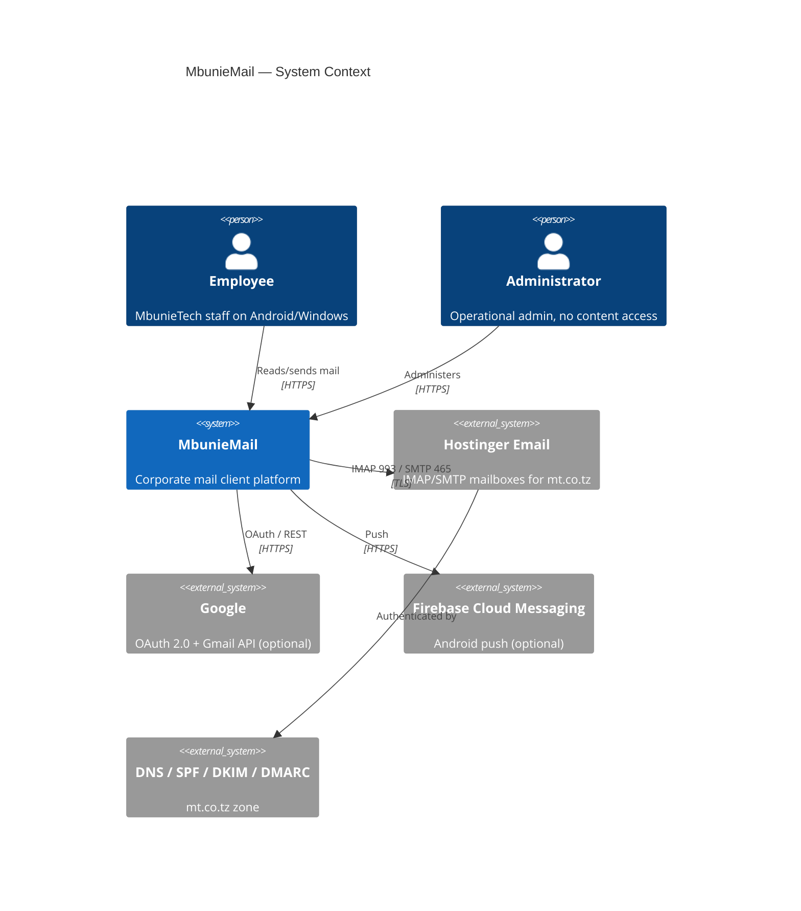
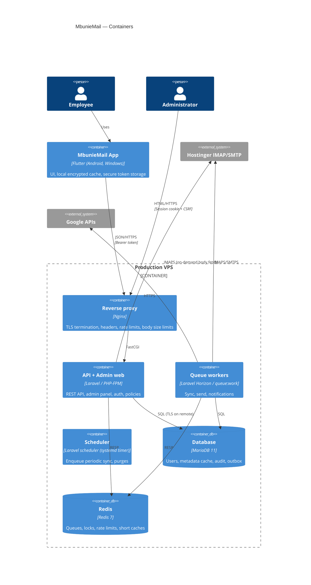
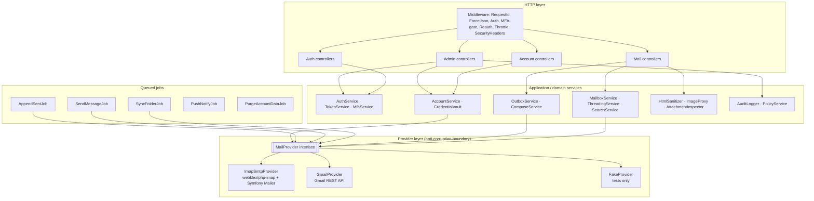
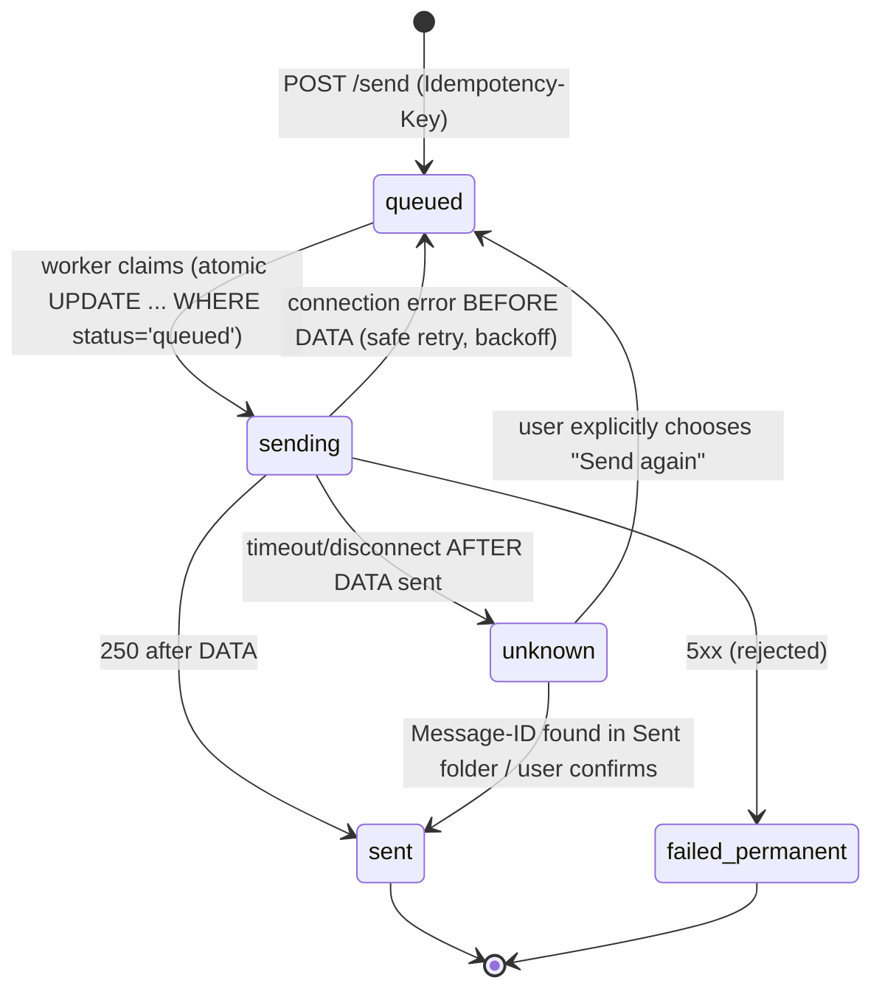

# MbunieMail — Software Design Description (SDD)

Version 0.1 · 2026-10-14 · Traces to SRS v0.1

---

## 1. Architecture overview

MbunieMail is a **backend-mediated mail client**. Flutter apps never talk to IMAP/SMTP or Google directly. They call the MbunieMail REST API. The Laravel backend holds encrypted provider credentials and talks to providers through **provider adapters**.

### 1.1 Key decision: server-side adapter vs. on-device IMAP

| Option | Pros | Cons |
|---|---|---|
| **A. Server-side adapter (chosen)** | Central policy, audit, revocation, and send limits. One implementation for Android and Windows. Push notifications possible. Gmail OAuth confidential client. Offboarding cuts access instantly | Backend holds mailbox credentials, so it is a high-value target. Server must scale IMAP connections. Hostinger must allow logins from the VPS IP |
| B. On-device IMAP/SMTP | Credentials stay on the device. No server mail load | No central revocation of mail access (password stays on device). Duplicate implementation risk. No push. Gmail needs a public client. Weak admin control |
| C. Hybrid | Flexibility | Two code paths, largest attack surface |

**Rationale:** the business goals (centralized control, auditing, instant offboarding, send-abuse limits, one codebase) favour A. The increased server risk is mitigated by envelope encryption of credentials, a dedicated key, strict network isolation, and least-privilege workers (see SECURITY_RISK_ASSESSMENT R-12). If Hostinger blocks VPS logins (A-2), fall back to B behind the same Flutter `MailRepository` interface. This is documented as ADR-001's contingency.

### 1.2 Key decision: data storage strategy (cache vs. copy)
**Selective metadata cache plus on-demand content.**
- **Stored:** envelope (from, to, cc, subject, date, Message-ID, In-Reply-To, References), flags, size, has-attachments, a 200-character plain-text snippet, thread key, and attachment *metadata* (name, type, size, part id).
- **Not stored:** full bodies and attachment bytes. These are fetched from IMAP when opened and streamed to the client.
- Optional short-TTL encrypted body cache in Redis (default **off**).
- Client: device-local encrypted cache of recently viewed lists and bodies (bounded, wiped on logout or revocation).

*Privacy implications:* the server DB still contains subjects, snippets and correspondents, which is sensitive personal data. These are classified **Confidential** (DATABASE_DESIGN §5). Subject and snippet columns are application-encrypted. A setting `MAIL_CACHE_SNIPPETS=false` removes snippets entirely. Full-text body search is delegated to IMAP `SEARCH`, so no body index exists server-side.

---

## 2. C4 diagrams

### 2.1 System context


### 2.2 Containers


### 2.3 Backend components


### 2.4 Trust boundaries
| # | Boundary | Controls |
|---|---|---|
| TB1 | Internet → Nginx | TLS 1.2+, HSTS, request size limits, IP rate limit, WAF rules (optional) |
| TB2 | Nginx → Laravel | Auth middleware, validation, policies. Trusted proxies set explicitly |
| TB3 | Laravel → DB/Redis | Localhost or private network only, separate DB users (app / migrator / backup), Redis AUTH + ACL |
| TB4 | Laravel → providers | Outbound TLS with verification. Egress allow-list to provider hosts |
| TB5 | Untrusted email content → app UI | Server sanitizer + client renderer without JS; image proxy |
| TB6 | Device storage | Keystore / DPAPI-protected tokens; encrypted local DB |
| TB7 | Admin → user data | Policy layer forbids admin access to content routes |

---

## 3. Repository structure
```
/                     monorepo
├── backend/          Laravel application (API + admin + workers)
├── app/              Flutter application (Android + Windows)
├── infra/            nginx, systemd, supervisor, docker-compose.dev.yml, scripts
├── docs/             this documentation set
└── .github/workflows CI (lint, test, audit, secret scan)  [when remote exists]
```

---

## 4. Flutter application architecture

- **Pattern:** feature-first, layered (presentation → application/state → domain → data).
- **State management:** Riverpod (`flutter_riverpod`, codegen optional). It is testable, has no BuildContext coupling, and suits async streams.
- **Navigation:** `go_router` with auth redirect guard and adaptive shells (`NavigationRail` / `Drawer`).
- **Networking:** `dio` with interceptors for auth header, single-flight token refresh, request id, and error-to-`AppFailure` mapping. TLS uses platform default validation. Optional certificate pinning (public-key SPKI pins of the API, with a backup pin) is an S item.
- **Secure storage:** `flutter_secure_storage` (Android: Keystore-backed. Windows: the implementation in use, Credential Manager or DPAPI, must be confirmed at implementation time and recorded in ADR-006).
- **Local cache:** `drift` + SQLCipher (`sqlcipher_flutter_libs`), with the DB key in secure storage. Caches lists and recently opened bodies (bounded LRU, 200 bodies max).
- **HTML rendering:** `flutter_widget_from_html_core`, which renders to native widgets with **no JavaScript engine and no WebView**. Remote `` is replaced unless consent is given, and then loaded via the backend proxy URL only. Links open only after a confirmation sheet showing the real URL.
- **Rich-text composer:** `flutter_quill` (Delta → HTML on the client, re-sanitized on the server).
- **Notifications:** `firebase_messaging` (Android, optional) and `flutter_local_notifications` (Android + Windows toasts).

```
app/lib/
  core/      (config, env flavors, theme, router, http, secure_storage, errors)
  features/
    auth/        (login, mfa, recovery, sessions)
    accounts/    (link, status, switcher)
    mailbox/     (folders, list, search)
    reader/      (message, thread, attachments, html_view)
    compose/     (composer, recipients, attachments, drafts)
    settings/
  shared/widgets/
```

Flavors: `dev` (allows `DEV DATA` fixtures, localhost API) and `prod` (fixtures compiled out via `const bool.fromEnvironment`, HTTPS only, release signing).

---

### 4.1 Implementation notes (Phase 6, 2026-10-14)
- Implemented with Riverpod 3.4, go_router 18, dio 5.11, flutter_secure_storage 11.2 and flutter_widget_from_html_core 0.17.
- **ADR-006 verified:** Android uses AES-GCM data encryption with an RSA-OAEP key in the Android Keystore; Windows uses DPAPI (`CryptProtectData`) plus Credential Manager.
- **Deviations from §4, recorded as open items:**
  - No SQLCipher/drift offline cache yet, so state is in memory only.
  - The composer is plain text converted to escaped HTML, not flutter_quill.
  - No FCM or local notifications yet.
  - Password-reset and invitation links open server-rendered pages (`/app/*`) instead of app deep links.
  - No certificate pinning.
- **Security properties enforced in code and tests:**
  - the bearer token is only sent to the API origin;
  - token refresh is single-flight, and a revoked session is wiped locally;
  - the Idempotency-Key is stable across retries;
  - HTML renders without a WebView or JavaScript; remote images only through the signed proxy after consent; links are confirmed before opening;
  - Android: `allowBackup=false`, data-extraction rules exclude everything, cleartext only in debug builds, minSdk 26.

## 5. Laravel backend design

### 5.1 Modules (namespaces under `app/`)
| Module | Contents |
|---|---|
| `Auth` | LoginController, MfaController, PasswordResetController, SessionController, TokenService (access + refresh), MfaService (TOTP via `pragmarx/google2fa`), RecoveryCodeService |
| `Accounts` | EmailAccountController, AccountService, CredentialVault (envelope encryption), ProviderProfile model |
| `Mail` | FolderController, MessageController, ThreadController, SearchController, AttachmentController, MailboxService, ThreadingService |
| `Outbox` | OutboxController (send, drafts), OutboxService, SendMessageJob, AppendSentJob |
| `Providers` | `Contracts\MailProvider`, `ImapSmtp\*`, `Gmail\*`, `Fake\*`, `ProviderFactory`, `ProviderError` taxonomy |
| `Sync` | SyncScheduler, SyncFolderJob, SyncState, Backoff |
| `Security` | HtmlSanitizer (`symfony/html-sanitizer`), ImageProxyController, AttachmentInspector (finfo + magic bytes + optional ClamAV), SecurityHeaders middleware, HIBP checker |
| `Audit` | AuditLogger, AuditLog model (append-only, hash-chained) |
| `Admin` | Blade + Livewire (or plain Blade) controllers for users, roles, policies, health, audit, jobs |

### 5.2 Policies (deny-by-default)
`EmailAccountPolicy`, `MessagePolicy`, `FolderPolicy`, `OutboxPolicy` each check `resource.user_id === auth.id`. **No `before()` bypass for admins.** `UserAdminPolicy` and `AuditPolicy` are permission-based. `Gate::before` is deliberately not used. A route-level `content` middleware group rejects any request from a token whose user has an admin role, unless that role holder is also accessing their *own* mailbox.

### 5.3 Provider abstraction
```php
interface MailProvider {
    public function capabilities(): Capabilities;             // MOVE, CONDSTORE, SPECIAL-USE, labels...
    public function verify(): VerificationResult;              // login test for IMAP+SMTP / token test
    public function listFolders(): array;                      // FolderDTO[]
    public function fetchChanges(FolderRef $f, SyncCursor $c, int $limit): ChangeSet; // new/changed/vanished + new cursor
    public function fetchMessage(MessageRef $m): MessageContent;    // raw MIME parsed -> parts (streamed)
    public function streamAttachment(MessageRef $m, string $partId): StreamInterface;
    public function setFlags(MessageRef $m, FlagChange $chg): void;
    public function move(MessageRef $m, FolderRef $to): MessageRef;
    public function delete(MessageRef $m, bool $permanent): void;
    public function search(FolderRef $f, SearchCriteria $q): array; // provider-native, criteria object (no raw strings)
    public function submit(OutgoingMessage $msg): SubmitResult;     // accepted | rejected | unknown
    public function appendToFolder(FolderRef $f, string $rfc822, array $flags): void;
}
```
`ProviderError` codes: `AUTH_FAILED`, `TLS_ERROR`, `UNREACHABLE`, `TIMEOUT`, `THROTTLED`, `NOT_SUPPORTED`, `MAILBOX_GONE`, `UIDVALIDITY_CHANGED`, `QUOTA_EXCEEDED`, `REJECTED`, `UNKNOWN_OUTCOME`. The business layer depends only on these.

Libraries: **`directorytree/imapengine`** (pure-PHP IMAP; see ADR-004) and **Symfony Mailer** with a per-account `EsmtpTransport` built at runtime. All TLS settings come from `App\Mailbox\ImapSmtp\TlsPolicy`: `verify_peer` and `verify_peer_name` are true, `allow_self_signed` is false, and the minimum is TLS 1.2. These are **hard-coded and not configurable**, and apply to implicit TLS and STARTTLS alike. STARTTLS is mandatory when selected (no plaintext fallback). Provider hosts are resolved once by `HostGuard` (private, reserved, CGNAT and multicast ranges refused), and the socket connects to that IP while the certificate is verified against the hostname (anti-DNS-rebinding).

*Implementation notes (Phase 4):*
- Provider code lives in `app/Mailbox` (`Contracts\MailProvider`, `ImapSmtp\*`, `Gmail\*`, `Fake\FakeProvider`, `ProviderFactory`).
- Sends are classified by `TrackingEsmtpTransport`, which records whether the end-of-data terminator was sent: failure before it is safe to retry; after it the outcome is `UNKNOWN_OUTCOME`.
- Sync fetches envelopes, flags, size, body structure, INTERNALDATE and one bounded text part per message for the snippet (read with `BODY.PEEK`, so nothing is marked read). Full bodies and attachments are fetched only on demand.
- CONDSTORE is not used yet. Flag changes are detected by re-reading flags of cached UIDs, which also detects expunged messages.

### 5.4 Provider profiles (anti-SSRF)
Users never type hostnames. Admins define `provider_profiles` (for example *Hostinger*: IMAP `imap.hostinger.com:993 ssl`, SMTP `smtp.hostinger.com:465 ssl`) via environment defaults and the admin UI. The allowed domain list maps email domains to profiles. Hostnames are resolved and rejected if they map to private, loopback or link-local ranges.

---

## 6. REST API conventions
- Base path `/api/v1`. JSON only. `Accept: application/json` is required.
- Auth: `Authorization: Bearer <access_token>`.
- IDs: ULIDs (non-sequential, so not enumerable).
- Pagination: cursor-based, `?cursor=…&limit=50` (max 100). The response includes `next_cursor`.
- Mutations accept `Idempotency-Key` (required on send).
- Errors: RFC 9457 `application/problem+json`:
```json
{ "type": "https://mbuniemail.mt.co.tz/errors/provider-auth-failed",
  "title": "Mailbox login failed",
  "status": 422,
  "code": "PROVIDER_AUTH_FAILED",
  "detail": "The mailbox password was rejected by the mail server.",
  "request_id": "01JA…",
  "errors": { "field": ["message"] } }
```
- Rate-limit headers: `RateLimit-Limit`, `RateLimit-Remaining`, `Retry-After`.
- Full detail in API_SPECIFICATION.md and openapi.yaml.

---

## 7. Database
See DATABASE_DESIGN.md for the ERD and tables.

---

## 8. Workflows

### 8.1 IMAP synchronization
```mermaid
sequenceDiagram
  participant SCH as Scheduler
  participant Q as Redis queue
  participant W as Worker (SyncFolderJob)
  participant L as Redis lock
  participant IMAP as Hostinger IMAP
  participant DB as MariaDB
  SCH->>Q: enqueue SyncFolderJob(account, folder) [unique job id]
  Q->>W: deliver
  W->>L: acquire lock sync:{account} (TTL 5 min)
  alt lock busy
    W-->>Q: release (no-op)
  end
  W->>DB: load sync_state (uidvalidity, last_uid, highestmodseq)
  W->>IMAP: SELECT folder (CONDSTORE if supported)
  alt UIDVALIDITY changed
    W->>DB: mark folder metadata stale, reset cursor, resync window
  end
  W->>IMAP: UID FETCH last_uid+1:* (ENVELOPE FLAGS BODYSTRUCTURE RFC822.SIZE, first 1KB text)
  W->>IMAP: UID FETCH 1:last_uid (FLAGS) CHANGEDSINCE modseq (or flag diff of window)
  W->>DB: upsert message_metadata ON DUPLICATE KEY (account, folder, uidvalidity, uid)
  W->>DB: delete vanished UIDs; update thread keys
  W->>DB: update sync_state (checkpoint) in same transaction
  W->>L: release
  W->>Q: enqueue PushNotifyJob for new unseen inbox items
```
Failures: `THROTTLED`/`UNREACHABLE`/`TIMEOUT` lead to `release($backoff)` with `backoff = min(cap, base·2^attempt)·random(0,1)` (full jitter). `AUTH_FAILED` sets the account to `auth_failed`, stops scheduling, and notifies the user. After max attempts (8), the job goes to `failed_jobs` (dead letter) with a redacted payload.

### 8.2 SMTP delivery (idempotent outbox)

- An `Idempotency-Key` is unique per user. A repeated POST returns the original outbox record.
- `Message-ID` is generated server-side (`<ulid@mt.co.tz>`) **before** submission, which enables reconciliation.
- After `sent`, `AppendSentJob` appends to Sent via IMAP APPEND (if the profile says the provider does not auto-save), and dedups by Message-ID search first.
- Limits: recipients ≤ 100, size ≤ 25 MB, per-user hourly limits enforced in Redis before queuing.

### 8.3 Gmail OAuth and API
```mermaid
sequenceDiagram
  participant App
  participant API as MbunieMail API
  participant G as Google
  App->>API: POST /accounts/gmail/authorize (authenticated)
  API->>API: create oauth_state(state=rand256, pkce verifier, user, exp=10min)
  API-->>App: { authorization_url }
  App->>G: open system browser (not WebView) to authorization_url
  G->>API: GET /oauth/google/callback?code&state (exact redirect URI)
  API->>API: validate & consume state (single-use, unexpired, matches user)
  API->>G: POST token (code + verifier + client_secret)
  G-->>API: access_token, refresh_token, scope
  API->>API: verify granted scopes ⊆ requested; encrypt & store
  API->>API: park tokens encrypted, issue one-time completion code
  API-->>App: redirect to app link #result=pending&completion=… (fragment; no tokens)
  App->>API: POST /accounts/gmail/complete {completion} (same session that started)
  API->>API: verify user + session family, store tokens via CredentialVault
```
- **Account-linking CSRF defence (implemented):** the callback cannot create an account by itself. Only the app session (refresh-token family) that requested the authorisation URL can redeem the completion code, so a flow finished in another person's browser is discarded.
- Scope (implemented): **only** `https://www.googleapis.com/auth/gmail.modify`, which covers read, label, move, trash and send. Granted scopes are verified after token exchange. **`gmail.modify` is a *restricted* scope**: a public app needs Google verification plus an annual third-party CASA security assessment. While in "Testing" mode or for an *Internal* Workspace app, limits apply (100 test users, 7-day refresh token expiry for testing apps). This is why Gmail is feature-flagged (SRS A-6).
- Refresh: lazy, on 401 or under 5 minutes to expiry, under a per-account lock. `invalid_grant` sets the account to `auth_failed`.
- Disconnect: `POST https://oauth2.googleapis.com/revoke`, then delete tokens and metadata.
- Sync uses `users.history.list` from the stored `historyId`. A `404` (history too old) triggers a full window resync.
- Quotas: honour `429`/`403 rateLimitExceeded` with backoff. Per-user units are tracked.

### 8.4 Authentication tokens
- **Access token:** Sanctum personal access token, `expires_at = now + 15 min`, abilities `['mail']`, or `['mfa-pending']` before MFA completes.
- **Refresh token:** a 256-bit random opaque token, stored as SHA-256 in `refresh_sessions` with a `family_id`. Rotated on every use. **Reuse of a rotated token revokes the whole family** (theft detection) and is audited. Absolute lifetime is 30 days, idle 7 days (configurable).
- Admin web uses Laravel session (cookie `__Host-` prefix, `Secure`, `HttpOnly`, `SameSite=Strict`), CSRF tokens, and a 30-minute idle timeout.

### 8.5 Remote image proxy (anti-SSRF, anti-tracking)
`GET /api/v1/image-proxy?u=<url>&sig=<hmac>`. The URL is signed by the server when it sanitizes the message (users cannot forge arbitrary URLs). The proxy accepts only `https` (and `http`, upgraded or refused by policy) on port 443/80, resolves DNS once and **pins the IP**, rejects private, reserved and loopback ranges (IPv4 and IPv6), follows no redirects to disallowed IPs (max 3), allows `image/*` only, caps size at 5 MB and time at 5 s, strips cookies and referrer, and re-encodes nothing (served with `Content-Security-Policy: default-src 'none'` and `X-Content-Type-Options: nosniff`).

### 8.6 HTML sanitization
Server-side `symfony/html-sanitizer` allow-list: text formatting, lists, tables, `a[href]` (http, https, mailto only, rewritten with `rel=noopener noreferrer`), `img[src]` (rewritten to `cid:` inline or a signed proxy placeholder). Inline `style` is allowed with a restricted property list (color, font, text-align, margin, padding, border, width). **Removed:** script, style blocks with `url()`, iframe, object, embed, form, input, base, meta refresh, svg, math, event handlers, `javascript:` and `data:` URLs (except `data:image/*` for inline images under 1 MB). The sanitized HTML is delivered with a plain-text fallback. The client renderer additionally ignores anything outside its widget set.

---

### 8.7 Implementation notes (Phase 5)
- **Sync:** `SyncService` runs inside `SyncAccountJob` (unique per account, `WithoutOverlapping`). The scheduler queues due accounts every minute (`mbuniemail:sync-due`). The inbox syncs every run; other folders every 15 minutes. Intervals adapt to client activity: 2 minutes, 15 minutes, or 60 minutes for dormant accounts. Each batch's metadata and its checkpoint are committed together. Auth failures stop scheduling (`next_sync_at = NULL`) until the user updates the password.
- **Threading:** Gmail thread id, otherwise Message-ID/In-Reply-To/References, including replies that arrive before their parent. Never by subject.
- **Outbox:** atomic `queued→sending` claim. The post-send steps (Sent copy, `\Answered` on the original, set on the server too, and a follow-up sync) can never change a delivered message's status. `mbuniemail:prune` turns `sending` rows older than 15 minutes into `unknown` (worker crash), never back into `queued`. Payloads and attachment files are deleted 24 hours after delivery; failed and unknown ones after 7 days.
- **Sanitizer:** `EmailHtmlSanitizer` uses Symfony's allow-list with three custom attribute sanitizers: CSS property allow-list (no `url()`), image source policy (`cid:`, small raster `data:`, remote images only through the signed proxy after consent), and a URL guard that reuses Symfony's `UrlSanitizer`. Outgoing HTML uses the same allow-list but keeps the author's own image URLs.
- **Image proxy:** HMAC-signed URLs with a purpose-bound key derived from APP_KEY via HKDF, one-hour expiry. Every hop, redirects included, is re-checked by `HostGuard` with **no** loopback exception and pinned with `CURLOPT_RESOLVE`. The response type is sniffed (raster only, no SVG), with a 5 MB and 5 s cap.

## 9. Secret management and token storage

| Secret | Storage | Protection |
|---|---|---|
| `APP_KEY` | `.env` on server, root-owned `0600`, never in VCS | Rotated using `APP_PREVIOUS_KEYS` |
| `CREDENTIAL_KEK` (mail and OAuth credential key-encryption key) | Separate file `/etc/mbuniemail/kek` (0400, owned by app user), **not** in `.env`, not in backups of the DB | Per-record DEK (XChaCha20-Poly1305 via libsodium). DEK wrapped by KEK. `kek_version` column supports rotation |
| Mailbox passwords, OAuth tokens | `encrypted_credentials` table | Envelope encryption (above) plus AAD = `account_id` to prevent row swapping |
| TOTP secrets | `users.mfa_secret` | Laravel `encrypted` cast (APP_KEY) |
| Recovery codes, refresh tokens, reset tokens, invitations | DB | Hash only (Argon2id for recovery codes; SHA-256 for high-entropy tokens) |
| DB / Redis passwords | `.env` | 0600 file. Separate DB users |
| Google client secret, FCM key | `.env` / file | 0600 |
| Device tokens | Keystore / Credential Manager | Never in SharedPreferences or plain files |

Key rotation: new KEK version, then a background job re-wraps DEKs (no data re-encryption needed), then the old KEK is retired after verification. Compromise procedure in INCIDENT_RESPONSE.md: rotate KEK, invalidate all stored mailbox credentials, force users to re-enter them, and coordinate Hostinger password resets.

Optional later: replace the file KEK with a KMS or HSM (for example HashiCorp Vault Transit) without schema change.

---

## 10. Queues, retries, idempotency, dead letters
- Queue driver: Redis (production). `database` driver fallback for local development if Redis is unavailable.
- Queues: `sync` (high volume), `send` (priority), `notify`, `maintenance`.
- Jobs implement `ShouldBeUnique` (sync per account+folder) and carry `$tries`, `backoff()`, `$timeout` (`sync` 120 s, `send` 90 s), and `retryUntil`.
- Idempotency: jobs reload state from the DB and check status before acting (outbox state machine; sync checkpoints). Upserts are keyed on natural unique keys.
- Dead letter: Laravel `failed_jobs` with a payload redaction hook (remove credentials and bodies). The admin UI lists, retries and purges these.
- Poison message protection: payload schema validated on handle, and max attempts enforced.

## 11. Logging, monitoring, backup, DR
- Logging: Monolog JSON to `storage/logs` (daily, 14-day local rotation) shipped to journald or a log server. A redaction processor masks `password`, `token`, `secret`, `authorization`, `cookie`, `code`, `body`, `subject`, `snippet` keys.
- Request ID is propagated (`X-Request-Id`).
- Health endpoints: `/up` (liveness), `/api/v1/health` (DB, Redis, queue lag; admin-only detail).
- Metrics: queue depth, job failures, sync lag per account, provider error rates, login failure rate (Prometheus exporter or a simple admin dashboard).
- Alerts: failed-login spikes, refresh-token reuse, provider auth failure spikes, queue lag over 10 minutes, disk over 80 %, certificate expiry under 14 days.
- Backup: nightly `mariadb-dump --single-transaction` encrypted with `age` to off-site storage. The KEK is backed up **separately** (offline, two custodians). Restore drill monthly (BACKUP_AND_RESTORE.md).
- RPO 24 h (metadata is re-syncable from the provider anyway). RTO 4 h.

## 12. Deployment topology
- **Local dev (Windows or Linux):** `php artisan serve` on port 8080 (port 8000 is occupied on the current dev host), MariaDB local, Redis via Docker (`infra/docker-compose.dev.yml`), plus Mailpit and GreenMail containers as fake IMAP/SMTP for integration tests.
- **Production:** a single VPS (Ubuntu 24.04 LTS). Nginx → PHP-FPM 8.4. MariaDB and Redis bound to localhost. systemd units for workers and scheduler. UFW allows 22 (restricted IP), 80, 443 only. Certbot TLS. Off-site encrypted backups. Separate optional staging VPS.

## 13. Architectural Decision Records (summary)
| ADR | Decision | Alternatives |
|---|---|---|
| 001 | Server-side provider adapters | On-device IMAP (fallback if Hostinger blocks VPS IP); hybrid |
| 002 | Metadata cache plus on-demand bodies | Full mailbox copy (privacy and storage cost); no cache (slow lists, no push) |
| 003 | Laravel Sanctum short-lived tokens plus custom rotating refresh sessions | Passport or OAuth server (heavier); JWT (harder revocation) |
| 004 | **`directorytree/imapengine`** (pure PHP, proper IMAP tokenizer/parser). *Revised in Phase 4:* `webklex/php-imap` 6.2 was evaluated first and rejected after it failed to parse BODYSTRUCTURE and `BODY.PEEK[...]` responses from a standards-compliant server | `webklex/php-imap`; `ext-imap` (removed from core in PHP 8.4); Node or Go sidecar |
| 005 | Envelope encryption with libsodium and a separate KEK file | Laravel `encrypted` cast only (key co-located with app); Vault (more ops, a future option) |
| 006 | Flutter secure storage (Keystore / Credential Manager) plus SQLCipher local DB | Plain shared_preferences (rejected) |
| 007 | Native-widget HTML rendering (no WebView) | WebView with JS disabled (larger attack surface; Windows WebView2 dependency) |
| 008 | Riverpod + go_router + dio | Bloc (more boilerplate); Provider (less structure) |
| 009 | Polling sync (2 min) first, IDLE later | IDLE now (one persistent connection per mailbox, Hostinger connection limits) |
| 010 | Gmail feature-flagged off for release 1 | Ship now (blocked by restricted-scope verification) |
