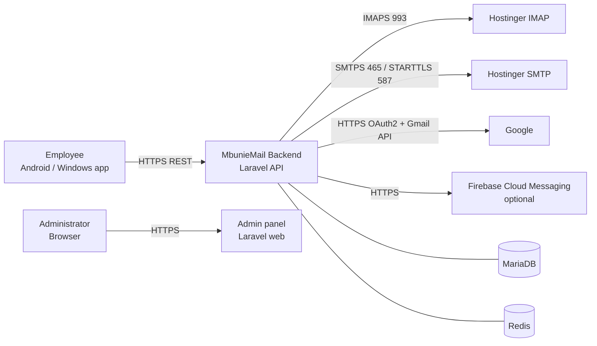

# MbunieMail — Software Requirements Specification (SRS)

| Field | Value |
|---|---|
| Product | MbunieMail |
| Owner | MbuniTech |
| Document version | 0.1 (draft for review) |
| Date | 2026-10-14 |
| Status | Draft. Requires stakeholder sign-off before implementation of dependent modules |

---

## 1. Purpose and scope

### 1.1 Purpose
This document states what MbunieMail must do and the quality attributes it must have. It is the reference for design (SDD), testing (TEST_PLAN) and acceptance.

### 1.2 Scope
MbunieMail is a corporate email client and backend for MbuniTech employees. It provides:

- An Android app and a Windows desktop app, both built from one Flutter codebase.
- A Laravel backend (REST API) that connects to the company's existing **Hostinger** mailboxes over IMAP and SMTP.
- A Laravel web administration panel.
- Optional connection of a personal or work **Gmail** account through Google OAuth 2.0 and the Gmail API (feature-flagged, see A-6).

MbunieMail is **not** a mail server. It does not host mailboxes, accept inbound SMTP, or provision Hostinger mailboxes in release 1.

### 1.3 Definitions
| Term | Meaning |
|---|---|
| Employee | An authorized MbuniTech user of the client apps |
| Mailbox / Email account | A provider mailbox (for example a Hostinger mailbox on `mt.co.tz`) linked to an employee |
| Provider adapter | A backend component that implements mail operations for one provider (Hostinger IMAP/SMTP, Gmail API) |
| Metadata cache | Envelope data (headers, flags, short snippet) stored by the backend. Full bodies are not stored by default |
| Operational admin | An administrator who manages users, policies and health, with **no** mailbox-content access |
| Break-glass access | An exceptional, approved, audited process for accessing mailbox content |

### 1.4 Priority scale
- **M (Must)**: required for the initial company release.
- **S (Should)**: high value; included unless it blocks release.
- **C (Could)**: desirable; deferred if necessary.
- **W (Won't, release 1)**: explicitly out of scope for release 1.

---

## 2. Business objectives and success criteria

| ID | Objective | Measurable success criterion |
|---|---|---|
| BO-1 | Employees use one professional client for company mail on phone and PC | ≥ 90 % of active employees log in at least weekly within 60 days of rollout |
| BO-2 | Centralized, auditable control of access | 100 % of employee accounts are created by invitation; 100 % of admin actions produce an audit record |
| BO-3 | Stronger account security than webmail-only access | MFA is enabled for 100 % of admins at launch and for 100 % of employees within 30 days (if policy is enforced) |
| BO-4 | Reliable mail | New mail appears in the client within 2 minutes (P95) of arrival at the provider. Sent-mail success ≥ 99.5 % excluding recipient-side rejections |
| BO-5 | Extensibility | A new provider can be added by implementing the provider interface, with no changes to controllers or the client UI |

---

## 3. Stakeholders and user roles

| Stakeholder | Interest |
|---|---|
| MbuniTech management (CEO) | Productivity, confidentiality, cost |
| Employees | Fast, reliable, easy mail on phone and desktop |
| IT / operational administrators | Onboarding, offboarding, policy, health |
| Security officer / Data Protection Officer (DPO) | Confidentiality, compliance (Tanzania PDPA 2022), incident response |
| Hostinger | Provider of mailboxes, IMAP/SMTP, DNS |
| Google (optional) | OAuth and the Gmail API, plus API verification requirements |

### 3.1 Roles (RBAC, deny-by-default)
| Role | Capabilities |
|---|---|
| `employee` | Use own mailboxes, settings, contacts, sessions |
| `admin` | Manage users, roles, policies, sessions, account connections, diagnostics, audit log (read). **No mail content** |
| `security_auditor` | Read-only access to the audit log and security events |
| `super_admin` | All `admin` capabilities plus managing admins and application-wide security settings. **No mail content** |
| `break_glass_approver` | Approves or declines break-glass requests. Cannot self-approve. Two-person rule |

Roles are composed of fine-grained permissions (see DATABASE_DESIGN `permissions`).

---

## 4. System context and external dependencies

External dependencies: Hostinger IMAP/SMTP (connectivity verified 2026-10-14: `imap.hostinger.com:993` and `smtp.hostinger.com:465/587`, TLS 1.3, valid certificate chain and hostname), DNS for `mt.co.tz` (MX points to Hostinger), Google APIs (optional), FCM (optional), TLS certificate authority (Let's Encrypt or other).

---

## 5. Functional requirements

Format: **ID — Title** · Priority · *Rationale* · Acceptance criteria (AC).

### 5.1 Authentication and account lifecycle (AUTH)

**FR-AUTH-001 — Employee login** · M
*Rationale:* Only authorized employees may access the system.
AC: (1) A valid email and password produces an access token (≤ 15 min TTL) and a refresh token (rotating). (2) Invalid credentials return a generic error that does not reveal whether the account exists. (3) Suspended or deactivated accounts cannot log in. (4) Each attempt is audited (success or failure) without logging the password.

**FR-AUTH-002 — Logout** · M
*Rationale:* Users must be able to end sessions.
AC: Logout revokes the current refresh session and access token. Later use of either returns 401.

**FR-AUTH-003 — Log out all sessions** · M
AC: The user can revoke all their sessions except the current one. Admins can revoke all sessions of a user (FR-ADM-006).

**FR-AUTH-004 — Password reset** · M
*Rationale:* Self-service recovery without exposing accounts to enumeration.
AC: (1) The request always returns the same generic response. (2) A single-use token is sent to the recovery address on file, is stored hashed, and expires in 30 minutes. (3) A successful reset revokes all sessions. (4) If MFA is enabled, completing the reset still requires MFA, or an admin-assisted reset. (5) Rate-limited per IP and per account.

**FR-AUTH-005 — Account deactivation** · M
AC: Deactivation immediately revokes all sessions and tokens, stops sync jobs, and disables provider connections. Data is retained per §10 and then deleted.

**FR-AUTH-006 — Invitation-only onboarding** · M
*Rationale:* Self-registration is disabled for release 1.
AC: The registration endpoint does not exist or returns 404. Invitations are single-use, expire in 72 h, and are stored hashed.

**FR-AUTH-007 — Multi-factor authentication (TOTP)** · M
AC: (1) Enrollment shows a QR code and secret once, and requires confirmation with a valid code. (2) The secret is stored encrypted. (3) Login requires a TOTP code when MFA is enabled. (4) Codes are single-use within their time step (replay rejected). (5) MFA attempts are rate-limited.

**FR-AUTH-008 — MFA policy enforcement** · M
AC: An admin can require MFA for all users or per role. A user without MFA who is subject to the policy is forced into enrollment after password login and can do nothing else. **MFA is always mandatory for every admin role.**

**FR-AUTH-009 — Recovery codes** · M
AC: 10 single-use codes are generated with a CSPRNG and shown once. Only hashes are stored. Use is audited. They can be regenerated after reauthentication.

**FR-AUTH-010 — Reauthentication for sensitive actions** · M
AC: Changing password or MFA, adding or removing mail accounts, regenerating recovery codes, and every admin write action require a password or MFA confirmation within the last 10 minutes.

**FR-AUTH-011 — Password policy** · M
AC: Minimum 12 characters. Checked against the breached-password corpus (k-anonymity HIBP range API, configurable, fails open with a logged warning if unavailable). Common and contextual passwords (company name, email) are rejected.

**FR-AUTH-012 — Session list** · S
AC: The user sees active sessions (device name, platform, approximate last-seen time, IP prefix) and can revoke any of them.

### 5.2 Mail accounts and connections (ACCT)

**FR-ACCT-001 — Link a Hostinger mailbox** · M
AC: (1) The user enters a mailbox address and password. Server settings come from admin-managed provider profiles (not free text, which prevents SSRF). (2) The backend verifies IMAP and SMTP login over TLS with certificate validation before saving. (3) The credential is stored encrypted (§6, SDD §9). (4) Failure returns an actionable error (bad credentials, TLS, timeout, throttled). (5) Only addresses on admin-allowed domains (default `mt.co.tz`) can be linked.

**FR-ACCT-002 — Multiple accounts** · S
AC: A user can link up to N accounts (admin-configurable, default 5). An account switcher and a unified inbox (C) are available.

**FR-ACCT-003 — Connection status and diagnostics** · M
AC: Each account shows its state (`active`, `syncing`, `auth_failed`, `provider_unreachable`, `throttled`, `disabled`), the last successful sync time, and the last error code with a human-readable remedy.

**FR-ACCT-004 — Update or remove a credential** · M
AC: Updating re-verifies the credential. Removing deletes the encrypted credential, cached metadata and sync state, and is audited.

**FR-ACCT-005 — Gmail connection via OAuth** · S (feature-flagged)
AC: (1) User-initiated. (2) Uses the Authorization Code flow with PKCE and a `state` bound to the user's session, single-use, 10-minute TTL. (3) The redirect URI matches exactly. (4) Only the minimum scopes are requested (SDD §8.3). (5) Tokens are stored encrypted. (6) Disconnecting revokes tokens at Google and deletes them locally. (7) MbunieMail never asks for a Gmail password.

**FR-ACCT-006 — Unsupported feature disclosure** · M
AC: When a provider does not support a capability (for example IMAP server without `MOVE`, Gmail labels versus folders), the UI shows it as unavailable with an explanation instead of failing silently.

### 5.3 Folders and messages (MAIL)

**FR-MAIL-001 — Standard folders** · M — Inbox, Sent, Drafts, Archive, Trash and Spam are mapped from IMAP `SPECIAL-USE` (RFC 6154) attributes, falling back to name heuristics. Mapping is visible in diagnostics.
**FR-MAIL-002 — Custom folders** · S — List, create, rename and delete custom folders when the provider supports it.
**FR-MAIL-003 — Message list** · M — Sender, subject, snippet (≤ 200 chars), date, unread, starred and attachment indicators. Cursor pagination with default 50 and max 100 per page. Sorted by date descending (default), date ascending, or sender.
**FR-MAIL-004 — Read message** · M — Body is fetched on demand, sanitized server-side (§6), and rendered with no active content.
**FR-MAIL-005 — Read/unread** · M — Toggled and synchronized to the provider (`\Seen`).
**FR-MAIL-006 — Star / flag** · M — Star maps to IMAP `\Flagged` (or the Gmail `STARRED` label).
**FR-MAIL-007 — Move, archive, delete** · M — Move uses `MOVE` (RFC 6851), falling back to COPY + `\Deleted` + `UID EXPUNGE`. Delete moves to Trash. Permanent delete only from Trash, with confirmation.
**FR-MAIL-008 — Spam actions** · S — Mark as spam or not spam (moves between Spam and Inbox).
**FR-MAIL-009 — Search** · M — Search by sender, recipient, subject, date range, has-attachment and unread. Body text search is delegated to the provider (IMAP `SEARCH TEXT`) and results are scoped to the selected account. Search input is validated and never concatenated into raw IMAP commands.
**FR-MAIL-010 — Conversation threads** · M — Threads are grouped using `Message-ID`, `In-Reply-To` and `References` (JWZ-style), plus Gmail `threadId` where available. A thread view shows messages in chronological order.
**FR-MAIL-011 — Bulk actions** · S — Select multiple messages to mark read or unread, move or delete (max 100 per request).

### 5.4 Composition and delivery (SEND)

**FR-SEND-001 — Compose** · M — To, CC and BCC with multiple recipients (max 100 total, configurable), subject, and rich text.
**FR-SEND-002 — Reply, reply-all, forward** · M — Correct `In-Reply-To` and `References` headers. The original is quoted. Forward includes the original attachments (optional).
**FR-SEND-003 — Attachments** · M — Upload limit 25 MB per message (configurable, ≤ provider limit). The MIME type is validated against the file signature. Filenames are sanitized. Executable types trigger a warning (blocked by policy option).
**FR-SEND-004 — Safe rich text** · M — Composer output is sanitized server-side with the same allow-list as for reading. A plain-text alternative part is generated.
**FR-SEND-005 — Idempotent send** · M — The client supplies an `Idempotency-Key`. The backend guarantees at most one SMTP submission per key. If the outcome is uncertain (timeout after `DATA`), the message is marked `unknown`, the user is told, and it is **not** automatically retried.
**FR-SEND-006 — Sent copy** · M — After a successful submission, a copy is appended to the Sent folder (IMAP `APPEND`) unless the provider is shown to save it automatically (verified per provider).
**FR-SEND-007 — Drafts** · S — Drafts autosave every 10 seconds to the backend outbox and to the provider Drafts folder (IMAP `APPEND`, replacing the prior version).
**FR-SEND-008 — Signature** · S — Per-account signature (sanitized HTML), inserted on compose.
**FR-SEND-009 — Send rate limiting** · M — Per-user and per-account send limits (default 100 messages per hour, 500 recipients per hour, below Hostinger limits) to contain a compromised account.
**FR-SEND-010 — Undo send** · C — 10-second configurable delay before submission.

### 5.5 Synchronization (SYNC)

**FR-SYNC-001 — Initial sync** · M — On link, the last 30 days (configurable) or 2,000 messages of metadata per folder are synced, newest first, without blocking the UI.
**FR-SYNC-002 — Incremental sync** · M — Uses `UIDVALIDITY` and UID checkpoints (and `CONDSTORE`/`HIGHESTMODSEQ` when available). For Gmail, uses `historyId`.
**FR-SYNC-003 — UIDVALIDITY change** · M — Triggers a resync of that folder's metadata with no duplicates.
**FR-SYNC-004 — Duplicate prevention** · M — Unique constraint on (account, folder, uidvalidity, uid). Message-ID is used for cross-folder thread dedup.
**FR-SYNC-005 — Retry with backoff** · M — Exponential backoff with full jitter (base 30 s, cap 30 min). Auth failures are not retried in a loop: the account is marked `auth_failed` and the user is notified.
**FR-SYNC-006 — Restart recovery** · M — Sync is resumable from persisted checkpoints after a worker or server restart.
**FR-SYNC-007 — Sync status** · M — The client shows the sync indicator, last sync time and errors.
**FR-SYNC-008 — Manual refresh** · M — Pull-to-refresh (mobile) and F5 / refresh button (desktop), rate-limited.

### 5.6 Notifications (NOTIF)

**FR-NOTIF-001 — New mail notification** · S — Android uses FCM push if configured, otherwise a periodic background fetch. Windows uses a local toast while the app runs.
**FR-NOTIF-002 — Privacy of notifications** · M — By default a notification shows only "New message from <sender display name>" and no subject or body. The user can opt in to showing the subject. Hidden on the lock screen by default.
**FR-NOTIF-003 — Preferences** · S — Per account and folder: on or off, and quiet hours.

### 5.7 Contacts (CONT)

**FR-CONT-001 — Recipient autocomplete** · M — Suggests from the user's own sent and received correspondents (derived from metadata) and the company directory (active employees). Results are scoped to the user.
**FR-CONT-002 — Contacts management** · C — Add, edit and delete personal contacts.

### 5.8 Settings and preferences (SET)

**FR-SET-001 — Preferences** · S — Theme (light, dark, system), density, default account, remote-image policy, notification preferences, signature.
**FR-SET-002 — Remote images** · M — Blocked by default. "Load images" applies per message or per trusted sender. Images are always fetched through the backend image proxy (§6).

### 5.9 Administration (ADM)

**FR-ADM-001 — Invite employees** · M
**FR-ADM-002 — Activate, suspend and deactivate users** · M
**FR-ADM-003 — Assign roles** · M (cannot elevate self; only `super_admin` can grant admin roles)
**FR-ADM-004 — MFA policy** · M
**FR-ADM-005 — Audit and security event review** · M (filter, export to CSV; the audit log is append-only)
**FR-ADM-006 — Revoke sessions and connected accounts** · M
**FR-ADM-007 — Service health and sync status** · M (queue depth, failed jobs, per-account sync state, provider reachability; **never** message content)
**FR-ADM-008 — Security settings** · M (allowed domains, provider profiles, rate limits, attachment policy, retention)
**FR-ADM-009 — Integration failures and jobs** · M (view and retry failed jobs. Payloads are redacted)
**FR-ADM-010 — Break-glass mailbox access** · S — A documented request with justification, a second approver, a time-boxed grant (≤ 24 h), full audit and notification to the DPO. The mailbox owner is notified unless legal hold prohibits it. The default implementation is **process-only** (no in-app content viewer for admins in release 1).

### 5.10 UI and platform (UI)

**FR-UI-001** · M — Responsive layout: single pane under 600 dp; two panes 600–1200 dp; three panes (sidebar, list, reader) above 1200 dp.
**FR-UI-002** · M — Light theme, plus an optional dark theme.
**FR-UI-003** · M — Loading, empty, offline, error and retry states on every data screen.
**FR-UI-004** · M — Development fixtures are visibly labelled "DEV DATA" and cannot be enabled in release builds.
**FR-UI-005** · M — Windows keyboard shortcuts: `C` compose, `R` reply, `A` reply all, `F` forward, `E` archive, `#` delete, `/` search, `J`/`K` next and previous, `Ctrl+Enter` send. Full Tab-order navigation.

---

## 6. Non-functional requirements

| ID | Category | Requirement |
|---|---|---|
| NFR-SEC-001 | Security | All traffic uses TLS 1.2+ (TLS 1.3 preferred). Certificate verification is never disabled |
| NFR-SEC-002 | Security | Secrets (mail passwords, OAuth tokens, TOTP secrets) are encrypted at rest with keys stored separately from the DB |
| NFR-SEC-003 | Security | Object-level authorization on every resource. Deny by default |
| NFR-SEC-004 | Security | Untrusted email HTML is sanitized server-side (allow-list) and rendered client-side without JavaScript, forms, iframes, or automatic remote fetches |
| NFR-SEC-005 | Security | No email bodies, passwords, tokens or OTPs in logs, analytics, crash reports or notifications |
| NFR-SEC-006 | Security | OWASP ASVS 4.0.3 Level 2 is the verification target |
| NFR-PERF-001 | Performance | API P95 under 300 ms for cached metadata endpoints and under 2 s for on-demand body fetch (excluding provider latency spikes) |
| NFR-PERF-002 | Performance | Message list renders the first page within 1 s on a mid-range Android device (cached) |
| NFR-SCALE-001 | Scalability | 200 employees × 3 accounts on a single 4 vCPU / 8 GB VPS. Horizontal scaling of workers without code changes |
| NFR-AVAIL-001 | Availability | 99.5 % monthly for the backend, excluding Hostinger outages, which are surfaced to users |
| NFR-REL-001 | Reliability | No lost sends. No duplicate sends caused by MbunieMail retries |
| NFR-MAINT-001 | Maintainability | Static analysis (PHPStan level ≥ 6, `dart analyze` clean), ≥ 70 % line coverage on backend domain and services |
| NFR-PORT-001 | Portability | Android 8.0 (API 26)+; Windows 10 22H2+ / Windows 11, x64 |
| NFR-OBS-001 | Observability | Structured JSON logs with request IDs, plus health and metrics endpoints |
| NFR-PRIV-001 | Privacy | Data minimization: bodies and attachments are not stored server-side by default |
| NFR-I18N-001 | Localization | English at launch. UI strings are externalized so Kiswahili can be added (S) |

---

## 7. User stories (selected) and acceptance criteria

| ID | Story | Acceptance |
|---|---|---|
| US-01 | As an employee, I accept an invitation, set a password and enroll MFA so I can use MbunieMail. | Invitation link works once, password policy is enforced, MFA is confirmed, recovery codes are shown once |
| US-02 | As an employee, I link `developer@mt.co.tz` with its mailbox password. | IMAP and SMTP verified, folders appear, inbox populates within 60 s |
| US-03 | As an employee, I read a phishing email safely. | Scripts, forms and iframes are stripped, remote images blocked, link targets shown on long-press or hover, external-sender banner shown |
| US-04 | As an employee, I reply-all with an attachment. | Recipients populate correctly, headers thread, the message appears in Sent, the recipient receives exactly one copy |
| US-05 | As an employee, I lose my phone. | I log in on the PC and revoke the phone session. The phone's next API call returns 401 and the app wipes local data |
| US-06 | As an admin, I offboard a leaving employee. | Deactivation revokes sessions, sync stops, and the audit record is written |
| US-07 | As an admin, I cannot read the CEO's email. | No admin UI or API exposes message content. Attempts return 403 and are audited |
| US-08 | As an employee, when Hostinger is down I see a clear banner and can still read cached message lists. | Banner reads "Mail provider unreachable, retrying", and cached lists remain viewable |

---

## 8. Platform compatibility

| Platform | Minimum | Notes |
|---|---|---|
| Android | 8.0 (API 26) | Tokens stored with `flutter_secure_storage` (Android Keystore-backed AES). `android:allowBackup=false`. Screenshot protection (`FLAG_SECURE`) is optional by policy |
| Windows | Windows 10 22H2 x64 | Tokens stored via the Windows Credential Manager / DPAPI (verified per plugin version). MSIX packaging, code-signed |
| Admin panel | Latest two versions of Chrome, Edge and Firefox | Server-rendered, CSP enforced |
| Build host | Windows builds **must be produced on a Windows machine** (Flutter limitation). Android builds can be produced on Linux | — |

---

## 9. Email synchronization and delivery requirements
- **SYNC-R1** Hostinger is reached via IMAPS (993, implicit TLS) and SMTP (465 implicit TLS or 587 STARTTLS, with STARTTLS required, not opportunistic). Values come from configuration, not code.
- **SYNC-R2** Poll intervals are 2 min for the Inbox of active accounts (accounts with a client session in the last 7 days), 15 min for other folders, and 60 min for dormant accounts. IMAP IDLE is a later optimization (C).
- **SYNC-R3** Per-account concurrency is 1 sync job at a time (distributed lock). Global IMAP connections are capped per provider (configurable, default 2 per mailbox, 50 total) to respect Hostinger limits.
- **SYNC-R4** Provider throttling responses (`[LIMIT]`, `NO [UNAVAILABLE]`, SMTP 421/451/452) set a cool-down and are surfaced.
- **SYNC-R5** **Delivery guarantee:** MbunieMail guarantees *at most once* SMTP submission per idempotency key. It cannot guarantee end-to-end delivery to recipients, because SMTP only confirms acceptance by the next hop. Bounces arrive as normal inbound mail (DSN parsing is C).

---

## 10. Data retention, privacy and audit

| Data | Stored where | Retention |
|---|---|---|
| Message metadata cache | MariaDB | While the account is linked. Purged within 24 h of unlink or deactivation |
| Message bodies | Not persisted. Optional encrypted Redis cache with TTL ≤ 15 min (default off) | ≤ 15 min |
| Attachments | Streamed. Temporary file ≤ 1 h for upload staging only | ≤ 1 h |
| Encrypted mail credentials / OAuth tokens | MariaDB (encrypted) | Until unlink or deactivation. Deleted immediately |
| Audit log | MariaDB (append-only), with daily signed export | 2 years (configurable), then deleted |
| Security logs (app/web server) | Log files | 90 days |
| Backups | Encrypted off-site | 30 days rolling |
| Mobile and desktop local cache | Device (encrypted DB) | Cleared on logout or remote revocation |

Privacy: processing is grounded in the employment relationship and company policy. Employees must be informed through an acceptable-use and privacy notice. The **Tanzania Personal Data Protection Act, 2022** and its 2023 regulations apply (registration of the data controller with the Personal Data Protection Commission (PDPC), purpose limitation, security safeguards, breach notification, and cross-border transfer conditions, since Hostinger and Google process data outside Tanzania). **Legal review is required. This document is not legal advice.**

Audit: every authentication event, admin action, credential change, account link or unlink, session revocation, break-glass step and policy change is recorded with actor, target, timestamp, IP, user agent, and a result. Never with message content or secrets.

---

## 11. Accessibility and usability
- WCAG 2.2 AA contrast (≥ 4.5:1 for text). Brand blue is checked against white and dark surfaces.
- Touch targets ≥ 48 × 48 dp. Supports system font scaling up to 200 %.
- Screen readers: Semantics labels on all interactive widgets (TalkBack, Narrator).
- Full keyboard operation on Windows (FR-UI-005) with a visible focus indicator.
- No information conveyed by color alone (unread uses bold plus a dot).
- Destructive actions are confirmable or undoable.

## 12. Error handling and recovery
- All API errors use one format (`application/problem+json`, see API spec) with a stable `code`, a human `title`, and a `request_id`. No stack traces or secrets.
- The client maps codes to actionable messages ("Your mailbox password changed. Update it in Accounts").
- Network loss: the client switches to offline mode, shows a banner, queues mutations (read and flag) idempotently, and replays them on reconnect. Sends are **not** queued offline in release 1 (they require explicit retry).
- Server: failed jobs go to a dead-letter table with redacted payloads, are visible to admins and are retryable.

## 13. Assumptions, constraints, exclusions

**Assumptions**
- A-1 Mailboxes are hosted on Hostinger Email. IMAP/SMTP endpoints `imap.hostinger.com`/`smtp.hostinger.com` were observed reachable, but **exact plan settings must be confirmed** from hPanel.
- A-2 Hostinger permits server-side IMAP/SMTP logins from the VPS IP (to be verified in an authorized test).
- A-3 Employees' mailbox passwords are known to the employee. MbunieMail does not create or reset them.
- A-4 A Linux VPS (Ubuntu 24.04 LTS or Debian 12/13) with a public DNS name (for example `mail-api.mt.co.tz`) will be provided.
- A-5 A Windows 10/11 machine is available for Windows builds and testing.
- A-6 Gmail integration is **feature-flagged off** for release 1 unless management approves Google verification costs and effort (restricted scopes require a CASA security assessment).

**Constraints**
- Hostinger offers no general mailbox-management API assumed by this design. Provisioning stays in hPanel.
- IMAP does not provide push to third-party servers. Near-real-time behaviour requires polling or IDLE connections.
- The development host (Kali Linux) has no Flutter SDK, Android SDK or Redis installed, and PHP lacks `pdo_sqlite`, `imap` and `redis` extensions (see ENVIRONMENT_AUDIT).

**Exclusions (W, release 1)**
Public registration; mailbox provisioning; calendar and contacts sync (CalDAV/CardDAV); S/MIME and PGP; iOS and macOS builds; DSN/bounce parsing; IMAP IDLE; in-app break-glass content viewer; offline send queue.
